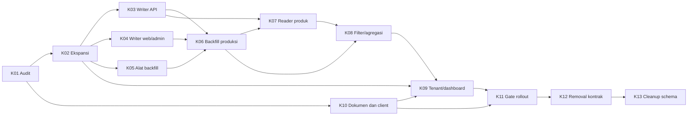

# Timeline — E20261003: Pemisahan Kategori Tenant dan Standardisasi Kategori Produk

- Dibuat: 2026-10-03; zona waktu Asia/Jakarta.
- Status: baseline rollout; implementasi lokal K02–K05/K07 tersedia sebagian/teruji sesuai catatan berikut. Deployment dan gate produksi belum terverifikasi.
- Epic: [E20261003](../../epic/E20261003-Pemisahan%20Kategori%20Tenant%20dan%20Standardisasi%20Kategori%20Produk.md).
- Target mulai: Senin, 5 Oktober 2026. Target selesai bersyarat: Jumat, 27 November 2026.

## Tujuan untuk tim

Kategori dipilih dan disimpan hanya pada produk melalui master database. Tenant memperoleh kategori agregat dari produk, tanpa kategori tunggal. Pekerjaan selesai setelah client bermigrasi, kontrak lama dihentikan, schema dibersihkan dan bukti verifikasi lengkap.

## Asumsi kapasitas dan estimasi

Baseline delapan minggu menggunakan dua engineer backend, satu PIC QA yang tersedia untuk tiap milestone, satu PIC operations/database, domain owner untuk mapping, dan PIC tiap client eksternal. Peran dapat dirangkap jika kapasitasnya cukup; nama personel belum ditetapkan. Estimasi tiket adalah effort hari kerja termasuk implementasi dan review/verifikasi terkait, bukan komitmen kalender. Effort perubahan aplikasi client eksternal belum termasuk dan ditentukan masing-masing PIC pada K01/K10. Kalender libur/cuti dan kapasitas aktual divalidasi saat kickoff.

Dua siklus rilis client diasumsikan berlangsung pada M4–M5. Periode observasi nol pemakaian kontrak lama adalah 14 hari berturut-turut setelah versi client aktif siap; target M6–M7. Ini baseline operasional dari rekomendasi yang disetujui, bukan bukti bahwa semua client sudah siap. Jika siklus client lebih panjang, mapping belum selesai atau gate gagal, geser removal/cleanup dan perbarui tanggal di sini.

## Timeline high level

| Minggu | Rentang tanggal 2026 | Pekerjaan utama | Milestone / bukti keluar |
| --- | --- | --- | --- |
| M1 | 5–11 Oktober | K01 audit; K02 mulai setelah keputusan audit; K10 koordinasi client mulai | Matriks kontrak/PIC, keputusan kompatibilitas, jadwal client, rencana ekspansi |
| M2 | 12–18 Oktober | K02 deploy ekspansi; K03 API, K04 web/admin, K05 alat backfill berjalan paralel; K10 dokumentasi | Schema tersedia, seluruh writer dual-write teruji/dirilis, tool dry-run siap |
| M3 | 19–25 Oktober | K06 mapping disetujui dan backfill; K07 reader dikembangkan; persiapan client | Produk termasuk soft-deleted seluruhnya memiliki ID valid; laporan rekonsiliasi |
| M4 | 26 Oktober–1 November | K07 reader dirilis; K08 filter/agregasi; K09 persiapan tenant/dashboard; K10 siklus rilis client pertama | Reader/filter ID terverifikasi; kompatibilitas tenant diuji; rilis client pertama |
| M5 | 2–8 November | K09 reader/dashboard aman sebelum create tenant tanpa kategori aktif; K10 siklus rilis client kedua; K11 verifikasi | Tenant tanpa kategori aman; seluruh versi client aktif siap; persiapan observasi |
| M6 | 9–15 November | K10/K11 observasi hari 1–7, rehearsal upgrade dan pemulihan, perbaikan bila ada | Tidak ada pemakaian fallback/endpoint lama; bukti client tidak membaca field lama |
| M7 | 16–22 November | K10/K11 observasi hari 8–14, rekonsiliasi ulang dan review gate | Release owner memberikan go/no-go berdasarkan semua bukti, bukan tanggal |
| M8 | 23–27 November | K12 removal awal minggu; minimal 2 hari kerja observasi; K13 backup, cleanup dan verifikasi akhir | Kontrak lama berhenti, schema target aktif, fresh/upgrade lulus; epic ditutup bila semua AC terpenuhi |

K07 dapat dikembangkan sebelum K06 selesai, tetapi perpindahan penuh reader menunggu rekonsiliasi. K09 dapat dipersiapkan lebih awal, tetapi create tenant tanpa kategori menunggu semua reader null-safe dan bukti kompatibilitas client. K12 dan K13 adalah rilis terpisah; tanggal cleanup mundur jika observasi removal belum lulus.

## Daftar tiket dan tanggung jawab

| Tiket | Hasil utama | Target | PIC peran | Dependensi | Estimasi effort hari kerja |
| --- | --- | --- | --- | --- | --- |
| [K01](../../DONE/E20261003/K01-Audit-kontrak-dan-keputusan-transisi.md) | Audit kontrak dan keputusan transisi | M1 | Engineering Lead | — | 2–3 |
| [K02](K02-Ekspansi-schema-dan-relasi-produk.md) | Ekspansi schema dan relasi produk | M1–M2 | Backend / Database | K01 | 2–3 |
| [K03](K03-Standardisasi-writer-produk-API.md) | Standardisasi writer produk API | M2 | Backend API | K02 | 3–4 |
| [K04](K04-Standardisasi-writer-web-dan-admin.md) | Standardisasi writer web dan admin | M2 | Backend Web / Admin | K02 | 2–3 |
| [K05](K05-Alat-audit-dan-backfill-kategori-produk.md) | Alat audit dan backfill kategori produk | M2 | Backend / Database | K02 | 3–4 |
| [K06](K06-Eksekusi-dan-rekonsiliasi-backfill.md) | Eksekusi dan rekonsiliasi backfill | M3 | Database / Operations + Domain Owner | K03, K04, K05 sudah dirilis | 2–3 |
| [K07](K07-Reader-dan-response-produk-berbasis-master.md) | Reader dan response produk berbasis master | M3–M4 | Backend API | K03, K06; pengembangan dapat dimulai setelah K03 | 3–4 |
| [K08](K08-Filter-dan-agregasi-kategori-tenant-berbasis-ID.md) | Filter dan agregasi kategori tenant berbasis ID | M4 | Backend API / Query | K06, K07 | 3–4 |
| [K09](K09-Tenant-tanpa-kategori-dan-dashboard-terdampak.md) | Tenant tanpa kategori dan dashboard terdampak | M4–M5 | Backend API / Dashboard | K02, K08, keputusan dan bukti kompatibilitas K01/K10 | 3–4 |
| [K10](K10-Dokumentasi-kontrak-dan-koordinasi-migrasi-client.md) | Dokumentasi kontrak dan koordinasi migrasi client | M1–M7 | Engineering Lead + Client PIC + Product | K01; finalisasi mengikuti K03–K09 | 3–5 internal; effort client dihitung oleh PIC |
| [K11](K11-Verifikasi-rollout-dan-readiness-gate.md) | Verifikasi rollout dan readiness gate | M5–M7 | QA + Release Owner | K03–K10; persiapan paralel, sign-off setelah semuanya siap | 3–4 |
| [K12](K12-Penghentian-kontrak-kategori-lama.md) | Penghentian kontrak kategori lama | M8 awal | Backend API + Client PIC | K11 sign-off, K10 selesai | 1–2 |
| [K13](K13-Cleanup-schema-dan-verifikasi-akhir.md) | Cleanup schema dan verifikasi akhir | M8 akhir | Backend / Database + Release Owner | K12 observasi lulus, backup dan gate K11 masih valid | 2–3 |

## Dependensi dan jalur yang menentukan selesai

Panah K10 → K09 hanya berarti keputusan/bukti kompatibilitas tersedia; K09 tidak menunggu seluruh periode observasi K10 selesai. K11 baru sign-off setelah seluruh K03–K10 selesai. Jalur teknis utama: ekspansi → semua writer → backfill → reader/filter → tenant/dashboard → gate → removal → cleanup. Kesiapan client dan observasi dapat menjadi jalur terpanjang walaupun backend selesai lebih awal.

## Keputusan transisi yang disetujui

1. Fallback teks hanya untuk edit ketika key product_category_id tidak dikirim. ID null/kosong/invalid ditolak 422; ID valid menang atas teks. Create tetap wajib ID.
2. Matching nama persis, lalu trim/normalisasi spasi/case hanya jika unik; tanpa fuzzy matching, default kategori, atau master otomatis. Mapping tak cocok/ambigu disetujui domain owner.
3. Writer API/web/admin menyimpan ID dan teks selama reader lama aktif. Backfill tidak menimpa ID valid dan tidak menimpa concurrent edit.
4. Tenant lama boleh mengirim category/category_id; input tersebut diabaikan juga setelah cleanup. Tidak mengarang kategori tunggal dari produk.
5. Aktivasi tenant tanpa kategori dipisahkan dari removal field response. Bila diperlukan, bentuk kosong sementara disepakati dan diuji client pada K01/K10; seluruh field lama akhirnya dihapus pada K12.
6. Slug master dipertahankan selama rollout. Client mengambil UUID dari master environment terkait; seeder tidak mengganti identitas master yang digunakan.
7. Jendela kompatibilitas awal dua siklus rilis client. Removal membutuhkan seluruh versi client aktif siap dan 14 hari berturut-turut tanpa pemakaian kontrak lama. Muncul pemakaian lama mengulang periode observasi setelah ditangani.
8. PostgreSQL sesuai produksi digunakan untuk rehearsal migration; deployment/runbook mengikuti Laravel Cloud. Backup/laporan/checkpoint harus durable.
9. Epic menunggu pekerjaan client eksternal, removal dan cleanup; milestone backend saja belum menutup epic.

## Gate rollout

| Gate | Sebelum tindakan | Bukti wajib | Pemilik keputusan |
| --- | --- | --- | --- |
| G1 | Deploy writer ID | Migration ekspansi sudah terpasang; FK/index dan upgrade teruji | Backend lead + operations |
| G2 | Jalankan backfill produksi | Seluruh writer dual-write aktif; dry-run dan mapping direview; batch/runbook siap | Operations + domain owner |
| G3 | Alihkan seluruh reader/filter ke ID | Rekonsiliasi semua produk termasuk soft-deleted; null/orphan nol | Backend lead + QA |
| G4 | Aktifkan create tenant tanpa kategori | Semua reader/dashboard null-safe; bentuk response kompatibel dan uji client lulus | Backend lead + client PIC |
| G5 | Hentikan kontrak lama | Seluruh client aktif siap, dua siklus rilis, observasi 14 hari nol pemakaian, seluruh writer/reader baru; K11 sign-off | Release owner |
| G6 | Drop kolom lama | K12 terobservasi minimal 2 hari kerja tanpa regresi terkait; gate data/client masih valid; backup dan pemulihan diverifikasi | Release owner + operations |
| G7 | Tutup epic | Fresh install/upgrade serta test lulus, semua AC terpenuhi, dokumentasi dan bukti client/deploy lengkap | Engineering lead + QA + product |

Field response yang dibaca client tidak dapat dibuktikan hanya dari log server. Bukti G5 menggabungkan telemetry fallback dan endpoint lama, audit/release client, kebijakan versi aktif/upgrade serta pengujian integrasi client. Jika bukti tidak tersedia, gate belum terpenuhi.

## Pengelolaan status dan risiko jadwal

Setiap PIC memperbarui status tiket, PR, hasil test dan blocker sebelum review mingguan. Release owner mencatat go/no-go pada milestone deployment. Inventaris data/client dan kapasitas aktual pada akhir M1 menjadi dasar re-estimasi; tanggal baseline tidak menjadi alasan melewati gate.

| Risiko jadwal | Tindakan dan dampak |
| --- | --- |
| Mapping tidak cocok/ambigu belum disetujui | Tahan G3 dan semua perpindahan reader penuh; domain owner menyelesaikan mapping |
| Writer lama/import/worker masih aktif | Tahan backfill final/non-null; tambah cakupan tiket writer dari hasil audit |
| Client lama masih aktif atau membaca field lama | Pertahankan kompatibilitas yang disepakati; geser removal/cleanup, bukan membuat kategori tenant pengganti |
| Rilis client lebih lambat dari asumsi | Perbarui dua siklus rilis dan tanggal mulai observasi; milestone backend tetap dilaporkan terpisah |
| Regresi setelah removal atau backup belum valid | Tahan G6; selesaikan regresi/rehearsal sebelum drop schema |
| Kapasitas tidak mendukung jalur paralel | Re-estimasi setelah K01; jangan memakai effort tiket sebagai durasi kalender |

## Bukti dan status saat ini

- K01: DONE untuk audit backend/API contract pada 2026-10-04; K02–K05/K07 mempunyai implementasi lokal dan K10 dokumentasi writer sebagian. K06/K08–K09/K11–K13 belum dijalankan; belum ada tiket tambahan dipindahkan ke DONE. PIC mobile, mapping kategori lama, operations/database dan release owner: Rindi; personel pelaksana lain belum ditetapkan.
- Matriks audit backend dan baseline data K01 tersedia: PostgreSQL 18.6 (4e955f5), 17 produk (10 non-soft-deleted, 7 soft-deleted), berdasarkan output query pengguna. Versi/uji mobile, ritme rilis aktual, hasil uji client/produksi, backfill dan deployment belum terverifikasi. Penutupan audit API tidak meluluskan gate produksi.
- Gate G1–G7: belum terpenuhi.
- Migration/backfill hanya dijalankan pada fixture database test terisolasi; belum ada migration, backfill atau deployment pada database bersama/produksi.

### Kelanjutan engineering lokal — 2026-10-04

- Perubahan K02 yang sudah ada dipertahankan. K03 API dual-write, resolver/fallback terukur dan response master teruji lokal. K04 web/master selection serta fixture dual-write teruji; implementasi admin diperbarui, UI Filament belum dapat diuji karena dependensi tidak terpasang.
- K05 command dry-run/apply, laporan S3 durable, batch/checkpoint/resume, rekonsiliasi dan guard concurrent edit tersedia. Runbook ada pada K05. Disk operasional aktual, tuning PostgreSQL dan persetujuan mapping belum terverifikasi.
- `php artisan test --filter='ProductCategoryBackfillTest|ProductCategoryWebWriterTest|ProductCategoryWriterApiTest|ProductCategorySchemaTest|SellerApiTest'`: **58 lolos, 484 assertion**, SQLite in-memory, fake storage S3. Pint dijalankan pada PHP perubahan. Tidak ada asset CSS/JS berubah; template Blade dirender dalam test web.
- PostgreSQL rehearsal tetap tertahan: binary server PostgreSQL tidak ditemukan; `docker version` mengonfirmasi Docker Desktop belum tersedia melalui WSL. Tidak memakai credential/database pengembangan atau produksi sebagai substitusi test.
- API_DOCUMENTATION.md dan ADR-012 diselaraskan untuk writer yang diimplementasikan; K10 client readiness tetap terbuka. Gate G1–G7 tetap belum terpenuhi; K06 operasi produksi menunggu deployment writer, mapping approved, rehearsal serta akses operasional. K07 dapat dikembangkan setelah K03, tetapi aktivasi seluruh reader tetap menunggu rekonsiliasi K06/G3.

- K07 dikembangkan sesuai izin urutan timeline setelah K03: reader produk/master, metadata berbasis slug dan nested cart tersedia secara lokal. Suite reader/writer/web/product/cart/seller: **67 lolos, 555 assertion**; tidak menjumlahkan angka dengan suite sebelumnya karena overlap. Perpindahan penuh tetap menunggu K06/G3, filter/agregasi K08 belum diubah.

- Pemeriksaan tambahan `php artisan test --filter=ProductDetailApiTest`: 1 lolos, 1 gagal (4 assertion). Kegagalan autentikasi mengharapkan `Unauthenticated.` sedangkan middleware existing memberi `Tidak terautentikasi.`; identik dengan kegagalan baseline yang sudah dibuktikan sebelum perubahan K02. Middleware dan ekspektasi test tersebut tidak diubah.

- Pemeriksaan akhir: Pint `--test` pada PHP perubahan reader/writer/tool lolos; PHP lint pada ketiga file admin lolos; `git diff --check` lolos. Working tree ditinjau, tanpa commit/push/deployment atau pemindahan tiket DONE.
